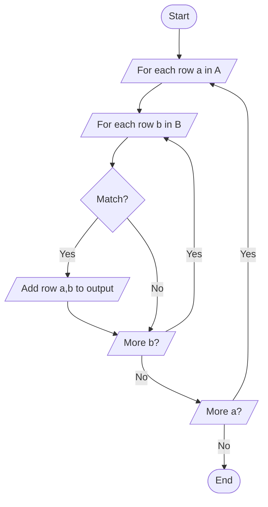
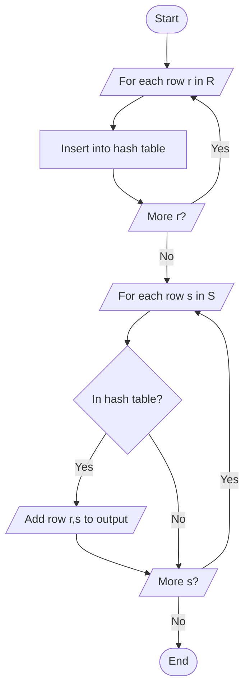
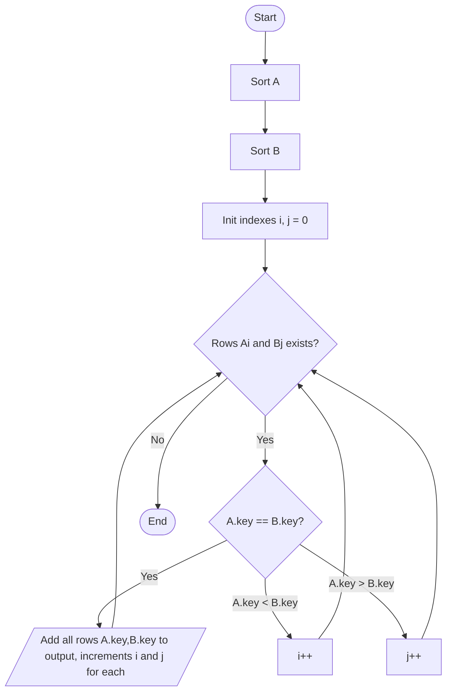

# Join implementations guide

## Nested Loop
#### Summary
**Each row from the first input is compared with every row of the second input in a nested loop.**
#### Diagram

#### Performance
**The worst of the three, except for very small datasets (10 rows or less).**
#### Complexity
**O(n * m)**
#### References
- https://en.wikipedia.org/wiki/Nested_loop_join
- [Understanding Nested Loops Joins](https://learn.microsoft.com/en-us/previous-versions/sql/sql-server-2008/ms191318(v=sql.100))

---
## Hash
#### Summary
**First, a hash table is built with the first input (usually the smaller) on the accessor field. Then, the second input is looped to search the accessor value in the hash table.**
#### Diagram

*Note: among the different existing subtypes, the Join task uses the classic (aka in-memory) hash join: the hash table is built from the smaller input, held in memory, and the other input is streamed.*
#### Performance
**Fast with large datasets.**
#### Complexity
**O(n + m)**
#### References
- https://en.wikipedia.org/wiki/Hash_join
- [Understanding Hash Joins](https://learn.microsoft.com/en-us/previous-versions/sql/sql-server-2008/ms189313(v=sql.100))
---
## Sorted Merge
#### Summary
**First, both inputs are sorted by their accessor. Then, a unique loop compares each row of the two inputs.**
#### Diagram

#### Performance
**The best of the three if datasets are already sorted (because sorting is the longest step). If not, performance is similar or slightly lower than hash join.**
#### Complexity
**O(n log n + m log m)** or **O(n + m)** (according to sorting of inputs)
#### References
- https://en.wikipedia.org/wiki/Sort-merge_join
- [Understanding Merge Joins](https://learn.microsoft.com/en-us/previous-versions/sql/sql-server-2008/ms190967(v=sql.100))
---
#### Global references
- [What are merge join, hash join, and nested loop?](https://gelovolro.medium.com/what-are-merge-join-hash-join-and-nested-loop-example-in-postgresql-29123ca18fd1)
- [Three types of join operations](https://learn.microsoft.com/en-us/previous-versions/sql/sql-server-2008/ms191426(v=sql.100)?redirectedfrom=MSDN)